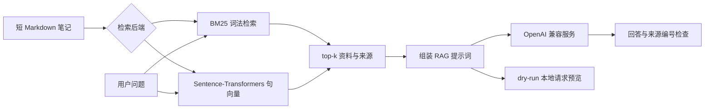

# LLM-Learning-Notes

[](https://github.com/tutuhong2001/LLM-Learning-Notes/actions/workflows/ci.yml)

**中文 AI 学习笔记检索与 RAG Demo：可运行代码 + 检索评估 + 技术分享。**

把 10 篇 AI 学习笔记变成一个小型问答知识库：先找资料，再使用 OpenAI 兼容服务生成带来源的回答。项目保留无需模型下载的 BM25 基线，也支持 Sentence-Transformers 中文语义检索，适合快速演示和面试讲解。

技术栈：**Python · Sentence-Transformers · Hugging Face / PyTorch 生态 · OpenAI Python SDK · pytest**。

## 能展示什么

| 功能 | 实现 |
| --- | --- |
| 中文文档检索 | BM25 词法基线；BGE 句向量 + 余弦相似度 |
| 最小 RAG | top-k 检索 → 上下文组装 → API 生成 → 来源编号检查 |
| 离线演示 | 不装第三方依赖即可检索、评估、预览生成请求 |
| 检索评估 | 20 个基础问题 + 8 个口语改写问题；Hit Rate、Recall、MRR |
| 技术分享 | 设计取舍、评估方法、框架 API、面试讲解 |
| 工程基础 | 可安装 CLI、自动化测试、GitHub Actions 配置、MIT 许可证 |



## 30 秒离线运行

需要 Python 3.10+。在**仓库根目录**运行，不需要 GPU、API Key 或第三方 Python 包：

```bash
git clone https://github.com/tutuhong2001/LLM-Learning-Notes.git
cd LLM-Learning-Notes
python -m ai_toolkit search "LoRA 为什么能减少训练参数？" --top-k 2
python -m ai_toolkit ask "RAG 与微调有什么区别？" --dry-run
python -m ai_toolkit evaluate --output outputs/bm25-eval.json
```

第一条命令返回来源与匹配分数；第二条展示将发送给模型的消息，**不会调用 API，也不会生成回答**；第三条输出检索评估报告。BM25 是传统检索基线，这条离线路径本身不运行神经网络。

示例（真实离线检索输出节选）：

```text
检索后端：bm25 | 命中文档：2

[1] finetuning.md | score=22.7090
# 微调与 LoRA

微调使用训练数据更新模型参数，适合调整输出风格、任务行为或特定任务表现。
LoRA 冻结原有权重，只训练低秩适配参数……
```

## 启用真正的语义检索

建议使用独立虚拟环境。Windows PowerShell：

```powershell
python -m venv .venv
.\.venv\Scripts\python.exe -m pip install -e ".[semantic,llm,dev]"
.\.venv\Scripts\python.exe -m ai_toolkit search "怎样少训练一些参数来适配任务？" --backend semantic
```

macOS / Linux：

```bash
python -m venv .venv
source .venv/bin/activate
python -m pip install -e ".[semantic,llm,dev]"
python -m ai_toolkit search "怎样少训练一些参数来适配任务？" --backend semantic
```

默认模型为 [`BAAI/bge-small-zh-v1.5`](https://huggingface.co/BAAI/bge-small-zh-v1.5)，在 CPU 上运行。第一次需要联网下载依赖与模型权重，后续可复用 Hugging Face 本地缓存。只需 API 调用时可安装 `pip install -r requirements.txt`，不必安装语义模型依赖。

`--embedding-model` 可以指定其他 Sentence-Transformers 模型；当前仅为默认 BGE 模型自动加查询指令。更换模型时需自行确认其输入约定和语言支持。每次启动会重新编码文档，尚未实现向量缓存。

## 启用 RAG 回答

在安装了 `llm` 依赖的环境中设置服务配置。以下 Windows 命令用占位符演示，请替换成自己的凭证与模型 ID：

```powershell
$env:OPENAI_API_KEY = "你的 API Key"
$env:OPENAI_MODEL = "服务商实际支持的模型 ID"
# 使用兼容服务时才设置；默认走 SDK 默认地址。
# $env:OPENAI_BASE_URL = "https://你的服务地址/v1"
.\.venv\Scripts\python.exe -m ai_toolkit ask "RAG 与微调有什么区别？" --backend semantic
```

macOS / Linux 对应使用 `export OPENAI_API_KEY="..."` 和 `export OPENAI_MODEL="..."`。不安装语义模型也能使用 `--backend bm25` 进行真实 RAG 调用。

`.env.example` 仅是配置参考，程序**不会自动读取 `.env`**。真实调用会把问题和命中的资料发送给所配置服务商，调用费用由该服务商决定。引用编号只能检查形式，仍需要人工核对回答依据。

## 评估与验证

```bash
python -m ai_toolkit evaluate --backend bm25 --output outputs/bm25-eval.json
python -m ai_toolkit evaluate --backend semantic --output outputs/semantic-eval.json
python -m ai_toolkit evaluate --backend bm25 --dataset data/eval_paraphrases.json --output outputs/bm25-paraphrases.json
python -m ai_toolkit evaluate --backend semantic --dataset data/eval_paraphrases.json --output outputs/semantic-paraphrases.json
python -m pytest -q
```

也可使用 `python scripts/verify.py` 一次运行测试、离线示例和两组 BM25 评估；加 `--semantic` 可同时验证语义检索。脚本把真实终端输出、指标报告和依赖版本写入 `outputs/`。

安装后的 `ai-notes` 命令与 `python -m ai_toolkit` 等价。所有命令可使用 `--help` 查看参数。默认读取当前目录下的 `data/knowledge`；从其他位置运行时，用 `--docs` 和 `--dataset` 指定实际路径。

本地实测结果与环境见 [交付验证记录](examples/validation.md)，逐题结果保留在 `examples/`。[首次发布的 GitHub Actions](https://github.com/tutuhong2001/LLM-Learning-Notes/actions/runs/37035326569) 已在 Windows / Linux、Python 3.10 / 3.12 四种组合下通过测试与 BM25 评估；CI 不下载语义模型，也不调用真实生成服务。

本地实测（2026-10-03，CPU，top-k=3）：

| 题集 | 后端 | Hit Rate@3 | Recall@3 | MRR@3 |
| --- | --- | ---: | ---: | ---: |
| 基础 20 题 | BM25 | 100.00% | 100.00% | 1.0000 |
| 基础 20 题 | BGE 语义检索 | 100.00% | 97.50% | 1.0000 |
| 口语改写 8 题 | BM25 | 62.50% | 50.00% | 0.4792 |
| 口语改写 8 题 | BGE 语义检索 | 75.00% | 68.75% | 0.5417 |

**24 项本地测试通过。** 神经网络语义检索已经实际运行；生成端已通过真实 SDK 配合模拟 HTTP 的测试，尚未使用用户的 API 凭证进行真实服务调用。

评估指标衡量的是**检索质量**，并非回答准确率。题集规模小且为人工自建，不能用于宣称通用模型能力。[指标定义与解读](notes/02-evaluation.md)中给出了多相关文档的计算示例。

## 仓库结构

```text
LLM-Learning-Notes/
├── ai_toolkit/
│   ├── retrieval.py        # BM25 与 Sentence-Transformers 检索
│   ├── rag.py              # 提示词、API 调用、引用格式检查
│   ├── evaluation.py       # 检索指标与逐题结果
│   └── cli.py              # search / ask / evaluate
├── data/
│   ├── knowledge/          # 10 篇短 Markdown 知识文档
│   ├── eval_questions.json # 20 个基础问题
│   └── eval_paraphrases.json # 8 个口语改写问题
├── examples/               # 实测报告与运行记录
├── notes/                  # 设计、评估、框架和面试笔记
├── tests/                  # 无需 API Key 的测试
├── .github/workflows/ci.yml
├── pyproject.toml
├── requirements.txt
└── LICENSE
```

## 技术笔记与面试演示

- [设计决策与适用边界](notes/01-design.md)
- [如何评估检索效果](notes/02-evaluation.md)
- [框架 API 与 Transformers 学习片段](notes/03-frameworks.md)
- [3 分钟演示顺序与简历条目](notes/04-interview.md)

可以在简历中描述为：**“基于 Sentence-Transformers 和 OpenAI 兼容接口实现中文笔记 RAG Demo，支持 BM25/语义检索对比、来源引用与检索指标评估。”** 展示前建议亲自跑一遍，并能解释检索失败案例。

## 已知限制与排错

- 知识库是人工整理的短文档；没有 PDF 解析、通用长文档分块或 token 预算管理。
- 没有训练或微调模型，没有 Agent 工具循环，没有线上部署。LoRA 与本地生成推理仅作为技术笔记。
- 无答案问题没有经过阈值校准，最近邻不一定相关；提示词拒答不能保证可靠。
- 模型下载失败：检查 Hugging Face 网络访问和本机代理配置；可先用 BM25 路径演示。
- Windows 依赖冲突：建议新建独立虚拟环境，不要混用已有 TensorFlow/科学计算包。
- API 错误：检查服务地址、模型 ID、凭证与额度。CLI 不打印原始服务错误详情，以免泄露请求内容。
- `score` 是排序分数；不同后端的原始分数不能直接比较。

## GitHub 仓库与后续更新

项目地址：[tutuhong2001/LLM-Learning-Notes](https://github.com/tutuhong2001/LLM-Learning-Notes)。克隆并修改项目后，仓库维护者可以提交更新：

```bash
git add .
git commit -m "docs: update learning notes"
git push origin main
```

建议仓库描述：`中文 AI 学习笔记与最小 RAG：Sentence-Transformers、BM25、OpenAI 兼容接口及检索评估。`

建议 Topics：`rag`、`sentence-transformers`、`embeddings`、`bm25`、`llm`、`python`。

许可证为 MIT；依赖与预训练模型遵循各自许可证。
